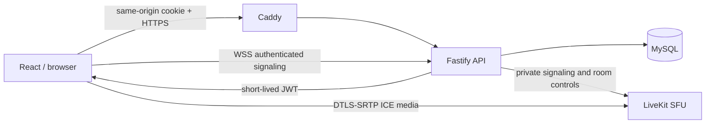
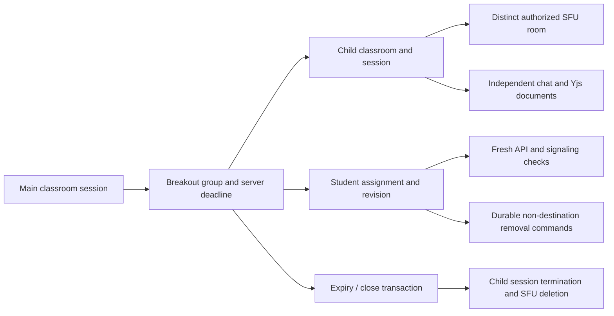
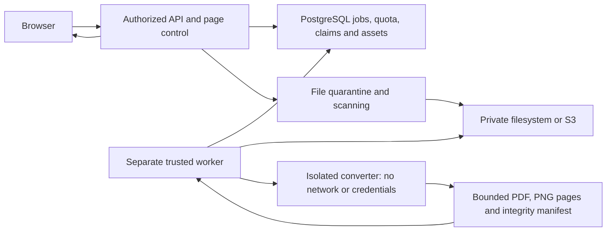

# Architecture decision record — 0001

Status: accepted for foundation; production approval pending.

React/Vite is chosen because the authenticated classroom needs browser media APIs and does not need server rendering. Fastify is a modular monolith. MySQL 8.4 is authoritative under the latest user scope; see MYSQL.md for native migrations and cutover evidence. The initial API runs without Redis; it is not yet suitable for multiple API replicas because abuse limits are process-local. Never interpret this as a horizontal scaling certification.

LiveKit was selected over mediasoup because its server and browser SDKs provide room signaling, subscription lifecycle, adaptive streaming, simulcast and recovery primitives. Mediasoup provides lower-level flexibility but would require implementing these application layers. SDK support is not evidence of tested network recovery. TOASTER now owns translated media controls and composes LiveKit hooks/renderers for actual tracks. The media room instance and connection effect are independent of the teaching timer's rerenders. Browser-native device names and permission pickers are not translated by the application.

Classroom and session IDs are server-generated UUIDs. Each active session has a distinct SFU room name. Membership is checked before token issuance and again on every signaling connection through an authenticated gateway. Policy versions reject stale grants. Durable, audited media commands apply per-source publishing restrictions, disconnect blocked media users and delete ended session rooms. See [media control architecture](MEDIA_CONTROL.md). Upstream SFU signaling must remain private; this is the enforcement boundary for self-hosted token revocation. Full classroom admission/RBAC and account-session media reconciliation remain unfinished.

Foundation model: users → auth_sessions; users ↔ organizations through memberships; organizations → classrooms → messages. Audit logs capture organization/member/classroom creation. Passwords use salted scrypt; only SHA-256 digests of random session tokens are stored. Membership uses explicit tenant filters at the service boundary. MySQL has no application row-level security policy; authorization requires explicit tenant filters and service permission checks.

Implemented boundaries include durable sessions, signed LiveKit webhook attendance, the authenticated realtime gateway, Yjs update storage and a database-backed media command worker. An isolated document converter worker and private filesystem/S3 assets are implemented and tested. Redis event fanout and recording workers remain planned. No empty feature modules are presented as implementations.

Reference review (2026-11-05):

- [BBB 4.0 release features](https://docs.bigbluebutton.org/4.0/new-features/) — navigation, apps, collaboration changes. Release stability must be checked at deployment; reviewed page includes prerelease notes.
- [BBB feature inventory](https://bigbluebutton.org/features/) — teaching tools and document support.
- [Skyroom official site](https://www.skyroom.online/) — Persian chat, media, screen share, whiteboard, cloud recording, event offering and API integration. Detailed enterprise behavior is unconfirmed; do not infer full parity from marketing.
- [LiveKit grants](https://docs.livekit.io/frontends/reference/tokens-grants/) — token permissions and self-hosted revocation limitation.
- [LiveKit deployment](https://docs.livekit.io/transport/self-hosting/deployment/) — trusted certificates and network requirements.

No reference branding, assets or source code were copied.

## Implemented teaching subsystem

Migration 002 adds active classroom sessions, hand raises, server-deadline timers, polls and responses, collaborative documents and append-only Yjs updates. WebSockets deliver invalidation events after committed mutations. Browser clients fetch authorized snapshots and merge unseen Yjs updates. Document mutations validate merged content, object types, coordinates, update size and storage quota under a document row lock. Default note limit: 10,000 characters; board: 5,000 objects, 256 points per stroke; log quota: 5 MB per document. Rich text, remote cursors, history and compaction are pending. This is a basic custom board, not a substitute claim for the complete Excalidraw-class requirement.

## Group room boundaries

See [breakout lifecycle](BREAKOUTS.md) for lock ordering, stale-command suppression, return and document copying. App media transitions wait for the previous stage's capture queue and disconnect cleanup before beginning another connection. Browser capture operations and device switches are serialized. Physical device recovery and adverse-network verification remain open.

The file/presentation subsystem follows the [storage decision](STORAGE_DECISION.md). Private files, quota/scan/cleanup state, durable conversion jobs, a separate trusted worker and synchronized presentation pages are implemented; see [presentation behavior and limits](PRESENTATIONS.md).

The API does not invoke Docker; deployments must separate service identities/socket permissions. Source and output integrity is verified before release. Production scanner deployment, orphan handling, queue fairness, Redis fanout, advanced annotations and clean deployment remain open.

## Media transport decision

The classroom UI explicitly selects LiveKit's supported dual-peer-connection mode. The default newer single-connection path showed intermittent camera disappearance in this Windows/WSL browser-device harness when audio was enabled after camera; SDK-only synthetic tests with audio-first publication did not expose it. The supported dual-connection mode passed the same camera-first UI workflow twice consecutively, including display capture, focus/grid and RTL controls. This is a transport configuration choice, not a reduced media feature set. It incurs a separate publisher/subscriber connection; capacity and recovery implications still need measurement. The upstream root cause is not proven beyond this observed configuration difference.
